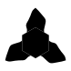

<p align="center">
  <a href="https://hydra-samo.github.io/valkhyn-studios/">
    
  </a>
</p>

<h1 align="center">VALKHYN — Portfolio Website</h1>

<p align="center">
  <strong>Video editing · Motion design · Voice-over — one unified head.</strong>
</p>

<p align="center">
  A flat, editorial studio site by <strong>Bendali Issam Eddine (VALKHYN)</strong> —
  the mythical three-headed craft, directed under a single will. EN / FR / AR, dark and light.
</p>

---

This repository is the **production website**, the self-contained tree that GitHub
Actions builds and deploys to GitHub Pages:

**https://hydra-samo.github.io/valkhyn-studios/**

The site is one page in six chapters — hero → about → services → work → process →
contact — written in **EN / FR / AR** with full RTL. The hero crossfades three muted
studio reels (editing → motion → voice); Services crossfades four atmosphere stills
(editing → motion → voice → delivery). The rest of the site uses flat editorial
bands and ruled rows, with no card grids or ambient pulsing indicators. Light
mode uses softened ink and a mid-deep emerald; media frames use 32px radii and controls are
pill-shaped, with every surface staying flat. Stack: React 19, TypeScript strict,
Vite 6, Tailwind v4, GSAP, Lenis. No backend, no router.

## Run locally

```bash
npm ci
npm run dev        # http://localhost:1717
```

Port 1717 is shared by the desktop launchers, the `hydra-studio.service` user
service and the tailnet proxy, so keep it stable.

## Build / checks

```bash
npm run build      # typecheck + production build to dist/
npm run lint       # TypeScript typecheck only (tsc --noEmit)
```

Both must be clean before pushing — the deploy workflow runs the same build.

## Deploy

`.github/workflows/deploy.yml` publishes `dist/` to GitHub Pages on every push to
`main` (and on manual dispatch). `vite.config.ts` keeps `base: './'` so assets
resolve from the `/valkhyn-studios/` subpath.

## Configuration

None. The site is fully static: no environment variables, no API keys, no form
endpoint. The Contact brief composes a real `mailto:` message in the visitor's
mail app. The social icons are monochrome placeholders until the real profile
URLs are available.

## Content

- **Copy** — every string lives in `src/i18n/translations.ts` (EN / FR / AR); the
  locale is persisted and RTL is applied from the same source.
- **Work** — `src/data/content.ts` stays empty until real, released projects
  exist. The gallery's empty state is deliberate: no fabricated case studies,
  clients, metrics or audio.
- **Images & video** — the real portrait lives in `public/portrait/`; the studio
  stills in `public/images/` and the two replacement hero reels in
  `public/video/` are from Pexels. The original editing reel is preserved.
  Services stills use art-directed 16:9 and 4:3 crops so the subject stays framed
  on desktop, tablet and phone. Sources and licence checks are recorded in
  `ASSET_CREDITS.md`; no credit links appear in the public footer. Nothing is
  presented as client work. `valkhyn-mark.svg` is the only logo file.
- **Metadata** — Open Graph, Twitter card, CSP, PWA icons and `site.webmanifest`
  are declared in `index.html`; `valkhyn_logo.jpg` is the share image.

## Performance & access

`src/hooks/useDeviceTier.ts` classifies the device (`low` / `medium` / `high`
from cores, memory, network class and pointer) and mirrors it to
`<html data-quality>`; Lenis smooth scroll steps down accordingly.
`prefers-reduced-motion` is honoured in every animated component.

A pre-paint script in `index.html` applies `data-theme` from local storage or
defaults to the light studio view on every device; `src/theme/ThemeContext.tsx`
owns the header toggle and keeps that choice in sync with `theme-color` and
`<html style="color-scheme">`.

## Structure

```
src/components/   one file per chapter + Nav, Footer, ThemeToggle, controls
src/theme/        ThemeContext + local-storage/OS preference handling
src/hooks/        useDeviceTier, useLenis
src/i18n/         LanguageContext + translations
src/data/         content (projects intentionally empty)
public/images/    credited Pexels atmosphere stills
public/video/     credited Mixkit + Pexels hero reels + posters
public/           mark, PWA icons, manifest, share image, portrait
```

---

<p align="center">
  <sub>Flat editorial studio system — Mythic Emerald on Abyssal Slate / neutral paper.</sub>
</p>
